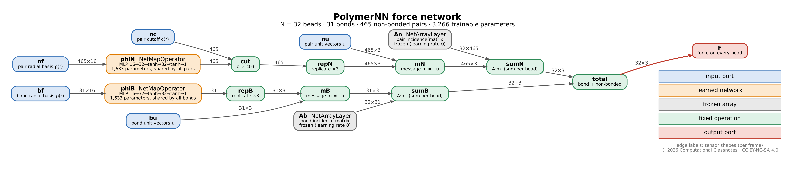

# Polymer Neural Nets: Wolfram Language edition

© 2026 Computational Classnotes · CC BY-NC-SA 4.0
Dara O Shayda · Noor Hoshino

This folder is a Wolfram Language version of the polymer force field, with no Python or OpenMM. It makes its own bead-spring chains and builds the same kind of graph network as the Python notebooks, with `NetGraph`. It trains the network by force matching and then runs new simulations with the learned forces, including on chains twice as long as any in the training set.

Tested with Wolfram 15.0 on macOS (Apple silicon).

## Contents

| file | what it is |
|---|---|
| [`PolymerNN-Wolfram.nb`](PolymerNN-Wolfram.nb) | **Graph Networks for Polymers in the Wolfram Language.** The main notebook covers the reference model, the chain as a graph, the network and its computational graph, training, the learned pair forces, the force errors, NVE energy conservation, and Langevin runs at N = 16, 32 and 64. It takes about 7 minutes on a laptop CPU. |
| [`NetLayers-Tutorial.nb`](NetLayers-Tutorial.nb) | **The Layers Behind a Graph Force Network.** This tutorial covers every layer the network uses, one at a time, on a four-bead chain, each checked against plain Wolfram Language. The layers are `LinearLayer`, `ElementwiseLayer`, `NetChain`, `NetMapOperator`, `ThreadingLayer`, `ReplicateLayer`, `NetArrayLayer` and `DotLayer`, followed by `NetGraph` with `NetPort` and `NetTrain`. It ends by training a mini force network to learn a spring. It takes about 15 seconds and does not need the package. |
| [`PolymerNN.wl`](PolymerNN.wl) | The package: reference model, compiled BAOAB Langevin and velocity-Verlet integrators, chain graph, network, training, learned and tabulated forces, observables, and `ForceNetGraphPlot`. Every function is commented. |
| [`docs/force-network.md`](docs/force-network.md) · [`.pdf`](docs/force-network.pdf) | The network layer by layer: the computational graph in colour, the tensor shape on every edge, and why each piece is there. |
| [`docs/force-net-graph-tb.png`](docs/force-net-graph-tb.png) · [`.svg`](docs/force-net-graph-tb.svg) | The computational graph drawn top to bottom, for pages. |
| [`docs/force-net-graph.png`](docs/force-net-graph.png) · [`.svg`](docs/force-net-graph.svg) | The same graph drawn left to right, for slides and screens. |
| `docs/*.dot` | Graphviz sources of the two figures. |
| [`scripts/`](scripts/) | The Python sources that write the two notebooks (`make_notebook.py`, `make_layers_notebook.py`, and `nbtext.py`, which typesets subscripts and superscripts in the text cells). |

## Running it

Put the three files `PolymerNN.wl`, `PolymerNN-Wolfram.nb` and `NetLayers-Tutorial.nb` in one folder, open a notebook and choose Evaluation → Evaluate Notebook. The main notebook loads the package from its own folder. Loops compile to C when a C compiler is installed (on macOS, the Xcode command-line tools), and otherwise to the Wolfram virtual machine.

To rebuild the notebooks from their sources, run `python3 make_notebook.py` and `python3 make_layers_notebook.py` in `scripts/`.

## The model

- **Reference.** Harmonic bonds (k = 100, r₀ = 1) plus WCA repulsion between all pairs, in reduced LJ units with T = 1. Dynamics are BAOAB Langevin with Δt = 0.005 and γ = 1.
- **Graph.** The beads are the nodes. The edges are the bonds and every non-bonded pair inside r_c = 1.5, with a smooth cosine cutoff.
- **Network.** On each edge the message is m = φ(ρ(r)) c(r) u. Here ρ is a 16-Gaussian radial basis, φ is an MLP 16→32→tanh→32→tanh→1 (one for bonds and one for non-bonded pairs), and u is the unit vector along the edge. The forces are F = A·m, where A is the incidence matrix, a frozen `NetArrayLayer`. Equivariance, Newton's third law and conservative forces hold by construction. There are 3,266 trainable parameters.
- **Prior and clamps.** A fixed repulsive core U₀ = (0.8/r)¹² is added on every edge, and the network learns the remainder. The network's input distance is clamped to the range covered by the data: r ≥ 0.88, and bonds ≤ 1.45. Without these two guards, long runs reach distances the network never saw, and the chains collapse or break.
- **Deployment.** The learned φ is sampled on a 4001-point table and run inside a compiled integrator. The table reproduces the network to about 2·10⁻⁵.

## Results

The results below are from one run, trained on 32-bead chains only. A fresh run of the notebook gives numbers within the error bars.

| check | result |
|---|---|
| force error, held-out 32-bead frames | 0.111 ε/σ (RMS force 13.3, so 0.8%) |
| force error, 64-bead chains never seen | 0.125 ε/σ (0.9%) |
| total force on the chain | 0 to machine precision |
| NVE, 5000 steps of Δt = 0.002: σ(E) | 0.0022 learned, 0.0021 exact |

Langevin runs used 4 chains × 500 frames for each force field:

| N | R_g reference | R_g learned | ⟨bond⟩ ref / learned | ⟨angle⟩ ref / learned |
|---|---|---|---|---|
| 16 | 2.44 ± 0.03 | 2.46 ± 0.03 | 1.093 / 1.093 | 109.2° / 109.3° |
| 32 | 3.88 ± 0.09 | 3.89 ± 0.11 | 1.093 / 1.093 | 108.9° / 109.3° |
| 64 | 6.62 ± 0.28 | 6.86 ± 0.27 | 1.093 / 1.093 | 109.4° / 109.8° |

The fitted exponent ν over N = 16–64 is about 0.72–0.78 for both force fields. That is above 0.588 because the chains are short, start straight, and the 64-bead runs are short compared with their relaxation time. What matters here is that the learned and reference forces agree at each N.

## Limits

- The networks are pair networks. That is exact for this reference model. Angle or torsion terms would need three- and four-body messages, as in NequIP or MACE.
- The networks are trusted only inside the distance range covered by the data.
- Everything runs on the CPU.
