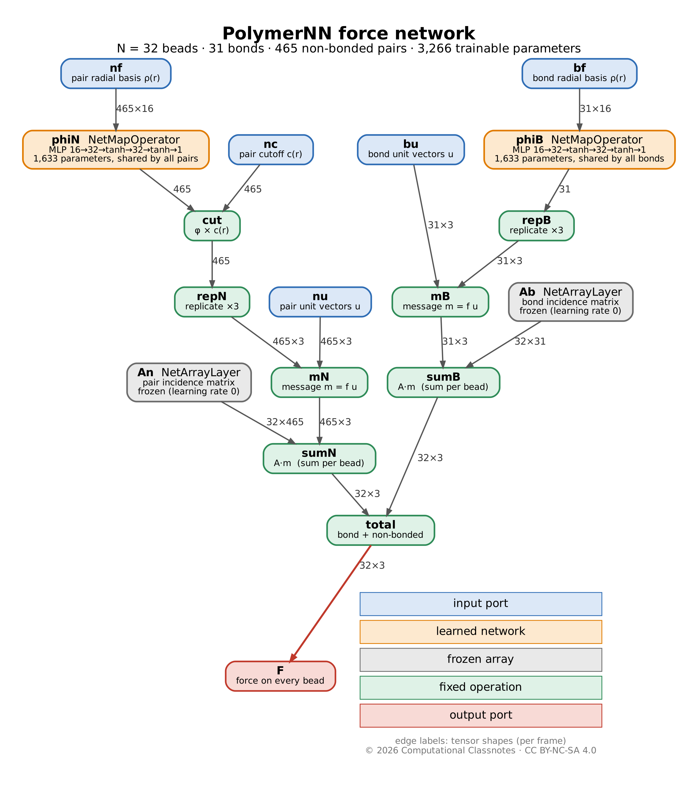

© 2026 Computational Classnotes · CC BY-NC-SA 4.0

This page describes the network that `BuildForceNet` builds in `PolymerNN.wl`. It gives each layer, the tensor shape on every edge, and the reason each piece is there. The shapes are for a chain of N = 32 beads, the length used in training. Shapes for any other N follow the same pattern (see [Shapes for any chain length](#shapes-for-any-chain-length)).

{width=100%}

A wide, left-to-right version of the same figure (for slides and screens) is in `force-net-graph.png` and `force-net-graph.svg`.

In the notebook, the same picture comes straight from the network object, with the shapes read from the net itself:

```wolfram
net0 = BuildForceNet[ChainTopology[32]];
ForceNetGraphPlot[net0]
Export["force-net-graph.png", ForceNetGraphPlot[net0], ImageResolution -> 300]
```

## Reading the picture

| Colour | Kind of node | Nodes |
|---|---|---|
| Blue | input port: data computed from the bead positions | `bf`, `bu`, `nf`, `nu`, `nc` |
| Orange | learned network: the only trainable weights | `phiB`, `phiN` |
| Grey | frozen array: constant data stored in the net, never trained | `Ab`, `An` |
| Green | fixed operation: no weights | `cut`, `repB`, `repN`, `mB`, `mN`, `sumB`, `sumN`, `total` |
| Red | output port | `F` |

The network has two branches with the same structure, one for non-bonded pairs and one for bonds. They join at `total`. In the figure above the non-bonded branch is on the left and the bond branch on the right; in the wide version and in the notebook they are the top and bottom rows.

## Inputs

A chain of N beads has N − 1 = 31 bonds (i, i+1) and (N − 1)(N − 2)/2 = 465 non-bonded pairs (i, j) with |i − j| > 1. For each of these edges, `EdgeFeatures` computes the following from the bead positions:

| Port | Shape | Meaning |
|---|---|---|
| `bf` | 31 × 16 | radial basis of each bond length, $\rho_k(r) = e^{-\gamma (r-\mu_k)^2}$, 16 centres $\mu_k$ from 0.6 to 1.5 |
| `bu` | 31 × 3 | unit vector $u = (x_i - x_j)/r$ along each bond |
| `nf` | 465 × 16 | radial basis of each pair distance |
| `nu` | 465 × 3 | unit vector along each pair |
| `nc` | 465 | smooth cutoff $c(r) = \tfrac12(\cos(\pi r/r_c) + 1)$ for $r < r_c = 1.5$, zero beyond |

The networks see the distance only through ρ, and only at a clamped value: r is never below 0.88, and a bond is never above 1.45. These are the edges of the range covered by the training data.

## Learned networks

`phiB` and `phiN` are `NetMapOperator`s around the same small chain:

LinearLayer 16→32 · tanh · LinearLayer 32→32 · tanh · LinearLayer 32→scalar

`NetMapOperator` applies this chain to every edge with the same weights, so `phiB` maps 31 × 16 to 31 and `phiN` maps 465 × 16 to 465. Each has 16·32 + 32 + 32·32 + 32 + 32 + 1 = 1,633 parameters. Together they have 3,266, and these are the only weights that training changes.

The output $\varphi(r)$ of each edge is a scalar pair force. A positive value pushes the two beads apart. Because all edges share the same weights, the trained networks do not depend on N, and they apply unchanged to chains of any length.

## Fixed operations

| Node | Layer | Shape in → out | What it does |
|---|---|---|---|
| `cut` | `ThreadingLayer[Times]` | 465, 465 → 465 | multiplies $\varphi$ by $c(r)$, so non-bonded forces fade to zero at $r_c$ |
| `repB`, `repN` | `ReplicateLayer[3, 2]` | P → P × 3 | copies each scalar three times, ready to multiply a 3-vector |
| `mB`, `mN` | `ThreadingLayer[Times]` | P × 3, P × 3 → P × 3 | the message on each edge: the force vector $m = f\,u$ |
| `sumB`, `sumN` | `DotLayer[]` | (32 × P), (P × 3) → 32 × 3 | A·m adds every edge message to its two beads |
| `total` | `ThreadingLayer[Plus]` | 32 × 3, 32 × 3 → 32 × 3 | bond forces plus non-bonded forces |

Here P is 31 for bonds and 465 for non-bonded pairs.

## Frozen arrays

`Ab` (32 × 31) and `An` (32 × 465) are the incidence matrices of the chain graph. Column p has +1 in the row of the first bead of edge p, −1 in the row of the second bead, and zeros elsewhere. So `sumB` and `sumN` give

$$F_i = \sum_p A_{ip}\, m_p ,$$

so each edge pushes its two beads with equal and opposite forces. The matrices are stored as `NetArrayLayer`s with `LearningRateMultipliers -> 0`, so training never changes them.

## Properties that hold by construction

1. **Equivariance.** The networks see only distances, which are unchanged by rotations and translations. The messages are scalars times unit vectors, so rotating the chain rotates every force in the same way.
2. **Newton's third law.** Every column of A sums to zero, so the total force on the chain is exactly zero (checked: $|\sum_i F_i| \approx 10^{-14}$).
3. **Conservative forces.** A central pair force $f(r)\,u$ is minus the gradient of $U(r) = \int_r^\infty f(s)\,ds$. The learned field therefore has a potential energy, and energy is conserved in NVE runs ($\sigma_E$ is 0.0022 learned vs 0.0021 exact).

## What training sees

`NetTrain` compares `F` with the residual reference force $F_\text{ref} - F_\text{prior}$, using a mean-squared loss. $F_\text{prior}$ comes from a fixed repulsive core $U_0 = (0.8/r)^{12}$ on every edge, which keeps beads apart at distances the data never reached. When the trained net is used, the prior is added back:

| Function | What it returns |
|---|---|
| `PairForceFunctions[net]` | the learned pair forces $\varphi$ + prior, as functions of r |
| `LearnedForces[net]` | forces on all beads, for a chain of any length |
| `TabulateForceField[net]` | a 4001-point table of the pair forces, for compiled MD |

## Shapes for any chain length

For N beads:

| Edge | Shape |
|---|---|
| `bf`, `phiB` input | (N − 1) × 16 |
| `nf`, `phiN` input | ((N − 1)(N − 2)/2) × 16 |
| `Ab` | N × (N − 1) |
| `An` | N × (N − 1)(N − 2)/2 |
| `F` | N × 3 |

For example, N = 64 has 63 bonds and 1,953 non-bonded pairs. `ForceNetGraphPlot` reads these shapes from whatever net it is given.
